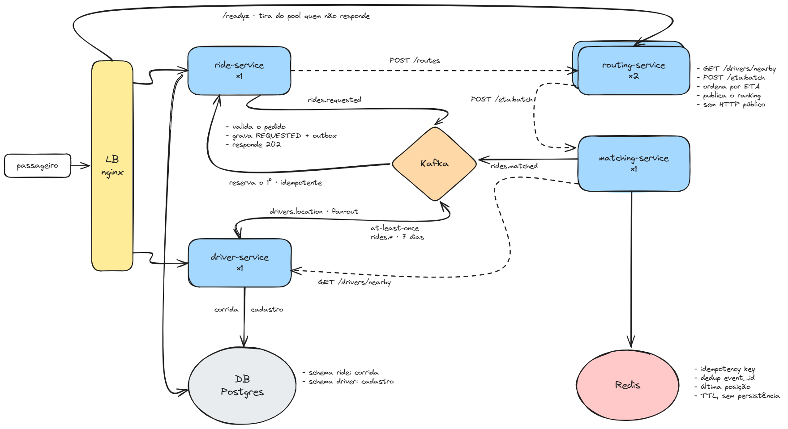

# nearby-drivers

Sistema de pedido de corrida que encontra o motorista disponível mais próximo do
ponto de embarque e devolve ao passageiro quem vem e em quanto tempo. A corrida
termina em `DRIVER_ASSIGNED`.

## Arquitetura

O passageiro entra pelo nginx, o único host dos serviços HTTP. Ride, driver e
matching sobem com uma instância. Só o `routing-service` sobe com mais de uma
réplica: o nginx balanceia essas réplicas na rede interna e tira do pool quem
não responde ao `/readyz`. O `POST /rides` grava a corrida e responde `202`
sem esperar motorista; o matching acontece de forma assíncrona via Kafka.

1. `ride-service` grava a corrida em `REQUESTED` com o evento na outbox e
   publica `rides.requested`.
2. `matching-service` consome o pedido, busca candidatos no `driver-service`
   (`GET /drivers/nearby`) e pede o ETA de todos ao `routing-service`
   (`POST /routes/eta:batch`) numa única chamada.
3. `matching-service` publica `rides.matched` com o ranking inteiro, ordenado
   por ETA.
4. `ride-service` reserva o primeiro motorista livre do ranking, passa a
   corrida para `DRIVER_ASSIGNED` e publica `rides.assigned`.
5. `driver-service` marca o motorista como `ON_TRIP` e publica
   `drivers.presence` (`lost`) se ele parar de mandar heartbeat, disparando um
   rematch.

A ordem de construção está em [doc/etapas.md](doc/etapas.md).

## Repositórios

| Serviço | Responsabilidade | Réplicas | Documentação | Repositório |
| --- | --- | --- | --- | --- |
| `ride-service` | Dono do estado da corrida: cria, atribui e cancela | 1 | [doc/ride-service.md](doc/ride-service.md) | [Matheusmottaa/ride-service](https://github.com/Matheusmottaa/ride-service) |
| `driver-service` | Cadastro do motorista e índice de posições em memória (KD-Tree) | 1 | [doc/driver-service.md](doc/driver-service.md) | [Matheusmottaa/driver-service](https://github.com/Matheusmottaa/driver-service) |
| `matching-service` | Monta o ranking de motoristas pelo ETA até o embarque | 1 | [doc/matching-service.md](doc/matching-service.md) | [Matheusmottaa/matching-service](https://github.com/Matheusmottaa/matching-service) |
| `routing-service` | ETA one-to-many sobre o grafo de ruas em memória | 2 | [doc/routing-serivce.md](doc/routing-serivce.md) | [Matheusmottaa/routing-service](https://github.com/Matheusmottaa/routing-service) |

## Infraestrutura

| Componente | Uso |
| --- | --- |
| nginx | Host único. Balanceia as réplicas do `routing-service` e faz o health check |
| Kafka | `rides.*` (7 dias), `drivers.location` (replay de 5 minutos), `drivers.presence` (1 hora) |
| PostgreSQL | Schema `ride` (corridas, outbox, idempotência) e schema `driver` (cadastro) |
| Redis | Idempotency key, dedup de `event_id`, reserva rápida e última posição. Só TTL, sem persistência |
