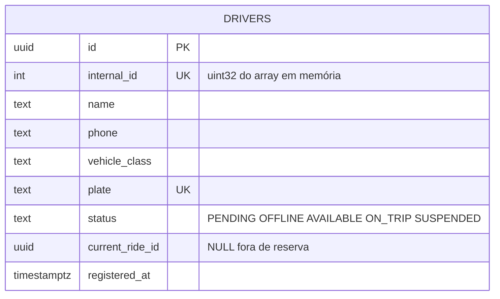

# driver-service

Dono do cadastro do motorista e do índice de posições. Responde quem está perto
de um ponto. Não escolhe motorista e não conhece corrida.

Roda em **2 réplicas** atrás do nginx. As duas atendem `GET /drivers/nearby`.
Cada uma mantém o próprio índice em memória; o Kafka mantém as duas alinhadas.

Na v2 este é o serviço central: a pergunta "quem está perto do embarque?" é
respondida aqui.

## O que faz

Há dois dados com o mesmo `driver_id` e vidas opostas:

| | Cadastro | Posição |
| --- | --- | --- |
| Exemplos | nome, placa, classe, status declarado | lat/lng, sequência, heartbeat |
| Frequência | dezenas de vezes por dia | a cada poucos segundos |
| Se o processo morrer | não pode se perder | pode se perder por alguns segundos; o replay reconstitui |
| Onde vive | PostgreSQL | array denso em memória + evento no Kafka |

Por isso o motorista **não tem coordenada no cadastro**.

1. `POST /drivers` grava o cadastro e atribui um `internal_id` denso (`uint32`),
   estável entre reinícios. Esse número é o índice do array de posições.
2. `PUT /drivers/{id}/location` valida o fix, grava o slot em memória se `seq`
   for maior que o atual, e publica `drivers.location`. O `204` sai depois da
   escrita local; o publish é assíncrono.
3. **Todas** as réplicas consomem `drivers.location`, inclusive a que publicou,
   e aplicam o fix no próprio array. Um snapshot de KD-Tree é reconstruído em
   background; a leitura usa o snapshot publicado mais um delta dos updates
   recentes.
4. `GET /drivers/nearby` consulta esse índice e devolve os K motoristas
   disponíveis dentro do raio.
5. Consome `rides.assigned` e `rides.released` para marcar o motorista como
   reservado ou devolvê-lo aos disponíveis.
6. Publica `drivers.presence` com `lost` quando um motorista reservado para de
   mandar heartbeat.
7. `PATCH /drivers/{id}/status` muda a declaração durável (`OFFLINE`,
   `AVAILABLE`, etc.).

No boot, a réplica carrega os `internal_id` e o estado `ON_TRIP` do Postgres,
faz replay dos últimos 5 minutos de `drivers.location` e só então marca
`/readyz`.

### Disponível

Um motorista entra no `nearby` quando as três condições valem:

- status declarado `AVAILABLE` no cadastro;
- heartbeat nos últimos 30 s (fato observado no slot em memória);
- não está reservado (`ON_TRIP`).

O bit de disponibilidade fica no slot, então um app que morreu sai da busca sem
escrita no Postgres.

## Contratos HTTP

| Método | Caminho | Quem chama | Resposta |
| --- | --- | --- | --- |
| `POST` | `/drivers` | App do motorista / operação | `201` com o recurso e o `id` |
| `GET` | `/drivers/{id}` | `matching-service`, operação | Cadastro, sem a trilha de GPS |
| `PATCH` | `/drivers/{id}/status` | App do motorista | `200`. Transição ilegal: `409` |
| `PUT` | `/drivers/{id}/location` | App do motorista | `204` sem corpo |
| `GET` | `/drivers/nearby` | `matching-service` | Lista de candidatos |
| `GET` | `/healthz`, `/readyz` | nginx | `/readyz` fica vermelho até o índice existir |

`POST /drivers` aceita `Idempotency-Key`.

`PUT /drivers/{id}/location` é o endpoint de maior volume. `seq` é obrigatório.
Um `seq` menor ou igual ao já aplicado devolve `204` e não altera o slot.

```http
PUT /drivers/018f9c00-3333-7abc-8def-0123456789ab/location
Content-Type: application/json

{
  "lat": -23.5601,
  "lng": -46.6588,
  "seq": 918342,
  "observed_at": "2026-09-30T18:00:00.812Z",
  "accuracy_m": 8.5
}
```

```http
GET /drivers/nearby?lat=-23.5613&lng=-46.6565&k=10&radius_m=3000&class=standard
```

```json
{
  "drivers": [
    {
      "id": "018f9c00-3333-7abc-8def-0123456789ab",
      "lat": -23.5601,
      "lng": -46.6588,
      "straight_line_m": 268,
      "vehicle_class": "standard"
    }
  ],
  "snapshot_age_ms": 187,
  "index": "kdtree"
}
```

A lista vem ordenada por `straight_line_m`. Lista vazia é `200`, não erro.
`k > 100`, `radius_m > 50000` ou coordenada inválida é `422`. Índice ainda não
construído é `503`, o mesmo sinal do `/readyz`.

## Comunicação com outras aplicações

| Destino | Canal | Para quê |
| --- | --- | --- |
| `matching-service` | **REST** `GET /drivers/nearby` (este serviço responde) | O matching precisa dos candidatos agora para chamar o ETA em seguida |
| `matching-service` | **REST** `GET /drivers/{id}` (este serviço responde) | Cadastro quando o nearby não trouxe o campo necessário |
| Réplicas deste próprio serviço | **Kafka** `drivers.location` | A réplica que recebeu o `PUT` é a única com o ponto novo em memória. As outras só ficam corretas se lerem o evento |
| `ride-service` | **Kafka** `rides.assigned` (consome) | Marcar o motorista como `ON_TRIP` |
| `ride-service` | **Kafka** `rides.released` (consome) | Devolver o motorista aos disponíveis após cancelamento ou rematch |
| `ride-service` | **Kafka** `drivers.presence` (produz) | `lost`: o motorista reservado parou de mandar heartbeat |

Não há REST de volta para o `ride-service`.

## Kafka — por que esta aplicação usa

**As réplicas não compartilham o índice.** O nginx pode mandar o `PUT` para a
réplica A e o `GET /drivers/nearby` para a réplica B. O padrão é fan-out: cada
réplica tem o **próprio** consumer group (`driver-index-<instância>`), então
cada uma recebe **todas** as mensagens.

**O boot precisa de uma janela para reconstruir.** Retenção de 5 minutos em
`drivers.location`. Chave: `driver_id`.

`rides.assigned` e `rides.released` também são fan-out, pelo mesmo motivo: o
bit `ON_TRIP` vive no slot de cada réplica. Cada uma aplica o bit em memória e
faz o `UPDATE` condicional no Postgres. As duas escrevem o mesmo valor, e a
condição em `current_ride_id` torna a segunda escrita um no-op.

| Tópico | Papel aqui | Quem mais participa | Retenção |
| --- | --- | --- | --- |
| `drivers.location` | produz e consome (fan-out) | só este serviço | 5 minutos |
| `drivers.presence` | produz (`lost`) | `ride-service` consome | 1 hora |
| `rides.assigned` | consome (fan-out) | `ride-service` produz | 7 dias |
| `rides.released` | consome (fan-out) | `ride-service` produz | 7 dias |

## Cache — por que esta aplicação usa

A busca espacial **não** passa pelo Redis. `nearby` lê o snapshot em memória.

| Chave | TTL | Conteúdo |
| --- | --- | --- |
| `driver:{id}:last` | 60 s | `lat`, `lng`, `seq`, timestamp |

Serve para a pergunta pontual "onde está este motorista agora?", por exemplo na
tela da corrida já atribuída.

## Banco de dados

O banco guarda **somente o cadastro** e o estado de reserva. Schema `driver`.



`current_ride_id` torna `rides.released` seguro: só libera se o `ride_id` do
evento for o da reserva atual. Um release atrasado de uma corrida antiga não
libera o motorista de uma corrida nova.

## Telemetria

| Métrica | Tipo | Por quê |
| --- | --- | --- |
| `http.server.duration` por rota e status | histograma | p50, p95 e p99 de `nearby` e `PUT /location` |
| `driver.nearby.results` | histograma | Muitas listas vazias indicam raio pequeno ou índice velho |
| `spatial.snapshot_age_ms` | gauge | Idade do snapshot da KD-Tree |
| `spatial.delta_size`, `spatial.delta_overflow` | gauge, contador | Delta crescendo além do rebuild |
| `spatial.rebuild_duration_ms` | histograma | Gatilho de sharding quando o p99 passa de 200 ms |
| `driver.location.stale_seq` | contador | `seq` velho descartado |
| `kafka.consumer.lag` (`drivers.location`) | gauge | Réplica atrasada responde com posição velha |
| `driver.replay.duration_ms` | gauge | Tempo do boot até `/readyz` |
| `driver.available` | gauge | Motoristas disponíveis no índice da réplica |

Spans: handler HTTP, consulta à KD-Tree, publish e consumo de
`drivers.location`.

## Idempotência

| Entrada repetida | O que acontece |
| --- | --- |
| `PUT` de localização com `seq` já aplicado | `204`, slot intacto |
| A mesma mensagem `drivers.location` lida de novo no replay | `seq` menor ou igual é descartado |
| `POST /drivers` com a mesma `Idempotency-Key` | Devolve o cadastro original, sem segundo `internal_id` |
| `rides.assigned` entregue duas vezes | `ON_TRIP` com o mesmo `ride_id` já é o estado alvo |
| `rides.released` de uma corrida que não é a atual | Ignorado |
| `lost` detectado pelas duas réplicas | As duas publicam com o mesmo `ride_id`. O `ride-service` só sai de `DRIVER_ASSIGNED` uma vez |

Log JSON com `service=driver-service`, `trace_id`, `driver_id` e `seq`.
