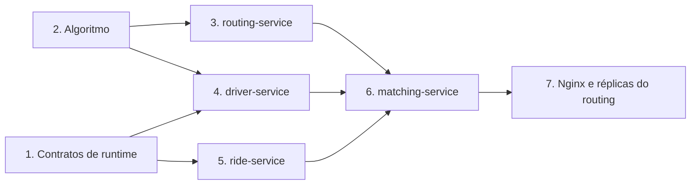
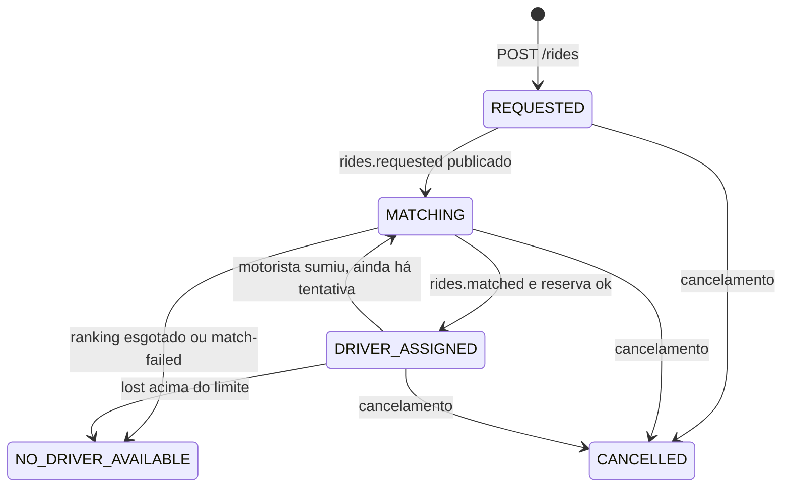

# Etapas de implementação

Ordem de construção. O passageiro pede uma corrida, o sistema acha o
motorista disponível mais próximo do embarque e devolve quem vem e em quanto
tempo. A corrida termina em `DRIVER_ASSIGNED`.

Este documento não reabre decisão. O comportamento de cada serviço está em:

- [ride-service](ride-service.md) — dono do estado da corrida
- [driver-service](driver-service.md) — cadastro e índice de posições
- [matching-service](matching-service.md) — ranking por ETA
- [routing-service](routing-serivce.md) — ETA one-to-many no grafo

Código neste repositório: quatro binários em `cmd/`, pacotes em `internal/`.
Go 1.24, standard library, e só `pgx`, `go-redis` e `franz-go` como dependência
externa. Toda etapa sai com teste (`go test -race ./...`).

O que já está marcado como feito está em [checklist.md](checklist.md).

## O que já está no repositório

| Peça | Estado |
| --- | --- |
| Postgres 17, schemas `ride` e `driver`, usuários separados | pronto em `deploy/postgres/init` |
| Redis só com TTL, sem RDB e sem AOF | pronto no `docker-compose.yml` |
| Kafka KRaft e os sete tópicos, com a retenção de cada um | pronto em `deploy/kafka/create-topics.sh` |
| Dockerfiles dos quatro serviços | prontos, apontam para `cmd/` |
| Tabelas `ride` e `driver` | prontas em `internal/ride/sql` e `internal/driver/sql` |
| nginx | pronto em `deploy/nginx`, no compose. O passageiro entra em `:8080`; routing em `nginx:8081` |
| Arquivo de grafo | `data/maps/graph.txt`, volume em `/data/maps` |
| Binários | `cmd/` dos quatro serviços. Saúde no ar; regra de negócio nas etapas abaixo |

Subir `docker compose up` e ver os healthchecks de Postgres, Redis e Kafka
verdes é o pré-requisito das etapas 4, 5 e 6. O mesmo compose sobe o nginx e
os quatro binários. A etapa 2 não precisa de container.

## Ordem

O núcleo geográfico não fala com rede, então vem primeiro e trava a semântica
de distância, ETA e desempate. O routing só serve esse núcleo por HTTP. O
driver precisa do mesmo núcleo mais Postgres e do replay de posição. O ride
grava a corrida e a outbox antes de existir matching. O matching é o último
serviço porque só compõe os outros dois HTTP com o evento do ride. Nginx e as
réplicas do routing entram quando uma instância de cada serviço já está
correta. Ride, driver e matching continuam com uma instância.



| Etapa | Infraestrutura | Algoritmo | API |
| --- | --- | --- | --- |
| 1 | fechar o que os processos assumem no boot | — | formato de erro e de evento, comum aos quatro |
| 2 | — | Haversine, KD-Tree, grafo CSR, Dijkstra one-to-many | — |
| 3 | arquivo de grafo montado em `/data/maps` | busca a partir do embarque, pool de buffers | `POST /routes/eta:batch`, `GET /nodes/snap` |
| 4 | schema `driver`, tópicos de localização e presença | snapshot de KD-Tree mais delta | cadastro, `PUT /location`, `GET /drivers/nearby` |
| 5 | schema `ride`, outbox, Redis de reserva | — | `POST /rides`, consulta, cancelamento, SSE |
| 6 | consumer group `matchers` | ranking `NearestETA` e fallback Haversine | sem rota de produto; o contrato é o evento |
| 7 | nginx, routing com 2 réplicas, os outros com 1, compose fechado | — | o passageiro entra por um único host |

## Números que as docs deixam em aberto

Estes valores são default de implementação, lidos de ambiente. As docs fixam o
comportamento, não a constante.

| Config | Default | Limite que a doc já impõe |
| --- | --- | --- |
| `RIDE_MAX_ATTEMPTS` | 3 | passado o limite, `NO_DRIVER_AVAILABLE`; rematch conta |
| `MATCH_K` | 10 | `nearby` recusa `k > 100`; `eta:batch` recusa mais de 50 origens. O K pedido ao nearby fica em 50 no máximo |
| `MATCH_RADIUS_M` | 3000 | `nearby` recusa `radius_m > 50000` |
| `HAVERSINE_SPEED_MPS` | 8.33 (30 km/h) | a doc manda distância em linha reta dividida por uma velocidade média |
| `ROUTING_POOL_SIZE` | `GOMAXPROCS` | pool cheio responde `503` com `Retry-After` |
| timeout de `nearby` e de `eta:batch` | 800 ms, 2 retries com jitter | retry só porque as duas chamadas são leitura |
| circuit breaker do matching | abre após 5 falhas seguidas, meia-abertura em 10 s | breaker aberto cai no Haversine; não vira `match-failed` |

Desempate do ranking, quando o ETA empata: `distance_m` menor, depois
`driver_id` crescente. Assim o teste é determinístico.

## Regras que atravessam as etapas

- `DRIVER_ASSIGNED` é o estado final de sucesso. `CANCELLED` e
  `NO_DRIVER_AVAILABLE` (depois do limite) também param aí. O rematch é a
  exceção: `lost` tira de `DRIVER_ASSIGNED` e volta para `MATCHING`.
- At-least-once é o contrato do broker. Cada consumidor é idempotente pelo
  estado do agregado, por `attempt` ou por `seq`.
- Redis sumir não perde corrida nem cadastro. A tabela de idempotência, o
  índice único de `assigned_driver_id` e o `attempt` no `ride-service` seguem
  valendo.
- `trace_id` nasce no `X-Request-Id` do `POST /rides`, vai no payload dos
  eventos e volta no `application/problem+json`. Log em JSON com `slog`,
  sempre com `service`, `trace_id` e o id do agregado.
- As métricas nomeadas nas docs de cada serviço são o contrato do que medir.
  Emissão inicial em log estruturado e contador em processo. Cliente de
  métricas ou de tracing é dependência nova e só entra com decisão explícita.

Erro HTTP, em todos os serviços que têm rota:

```json
{
  "type": "about:blank",
  "title": "unprocessable entity",
  "status": 422,
  "detail": "k must be <= 100",
  "trace_id": "req-abc123"
}
```

Content-Type `application/problem+json`.

---

## Etapa 1 — Contratos de runtime

Objetivo: os quatro processos sobem, respondem saúde e falam o mesmo erro e o
mesmo envelope de evento. Ainda sem regra de negócio.

### Infraestrutura

- `cmd/<serviço>/main.go` lê ambiente (`os.Getenv`), abre as dependências que
  aquele serviço usa e desliga no sinal com `context`.
- `GET /healthz` responde 200 com o processo vivo. `GET /readyz` responde 503
  até o que a doc daquele serviço exige estar pronto (grafo, índice, banco).
- Postgres, Redis e Kafka continuam os do compose. Nenhum serviço cria tópico
  em runtime: `KAFKA_AUTO_CREATE_TOPICS_ENABLE` já está desligado.
- DDL fica em SQL versionado do serviço dono do schema (`ride` ou `driver`) e
  roda como o usuário daquele schema. O init do compose só cria schema e role.

### API

Envelope de evento, igual nos sete tópicos:

| Campo | Onde |
| --- | --- |
| `event_id` | todo evento; estável se a outbox reenviar |
| `trace_id` | herdado do pedido |
| chave Kafka | `ride_id` nos tópicos `rides.*`, `driver_id` em `drivers.*` |

Os corpos de `rides.requested`, `rides.matched` e `rides.match-failed` são os
exemplos do matching-service. `rides.assigned` e `rides.released` levam
`ride_id` e `driver_id`. `drivers.presence` leva `lost` com o `ride_id` da
reserva. `drivers.location` leva o mesmo corpo do `PUT /location` mais o
`driver_id`.

### Pronto quando

Os quatro binários compilam (`make build`), cada um responde `/healthz`, e um
teste de mesa serializa e desserializa cada evento sem campo a mais nem a
menos em relação às docs.

---

## Etapa 2 — Núcleo do algoritmo

Objetivo: distância, índice espacial e ETA corretos num pacote puro, sem HTTP,
sem banco e sem Kafka. Esta etapa é o que o `GET /drivers/nearby` e o
`POST /routes/eta:batch` vão chamar.

Pacotes: `internal/geo`, `internal/kdtree`, `internal/graph`.

### Haversine

`geo.Point` com latitude e longitude. Distância em metros. Coordenada fora de
`[-90, 90]` ou `[-180, 180]` é erro de validação, o mesmo erro que as rotas
traduzem para `422`.

O fallback do matching usa esta distância dividida por `HAVERSINE_SPEED_MPS`.
O resultado é `eta_s` e `distance_m`, com `engine: haversine-fallback`.

### KD-Tree

Árvore 2D sobre coordenadas projetadas em metros locais, para o corte não
distorcer com grau de latitude. A distância devolvida ao chamador continua
sendo Haversine.

Duas construções, a mesma árvore:

| Uso | Vida | Consulta |
| --- | --- | --- |
| Nós do grafo | imutável depois do boot | vizinho mais próximo, para snapping |
| Motoristas disponíveis | snapshot substituído por ponteiro atômico | K vizinhos dentro do raio, ordenados por linha reta |

A variante dos motoristas não é consultada direto no array. O escritor atualiza
o slot e anexa o update num delta. Um rebuild em background copia os slots
disponíveis, publica outro snapshot e descarta o delta já incorporado. A
leitura usa o snapshot publicado e aplica por cima o delta mais novo, filtra
classe e raio, ordena por `straight_line_m` e corta em K.

Índice ainda não publicado é erro, traduzido para `503` na etapa 4.

### Grafo e Dijkstra one-to-many

Arquivo versionado, o mesmo em toda réplica. Formato de fixture do repositório,
texto, suficiente para teste e para o volume `/data/maps`:

```
graph_version
<n_nodes> <n_edges>
<id> <lat> <lng>
...
<from> <to> <distance_m> <duration_s>
...
```

O loader produz:

- grafo dirigido em CSR, só leitura, aresta com `distance_m` e `duration_s`;
- grafo reverso, as mesmas arestas invertidas;
- KD-Tree dos nós.

Não há escrita no grafo depois do load.

O ETA de K origens até um destino é uma busca de Dijkstra no grafo reverso,
partindo do nó do embarque (destino da chamada). O peso é `duration_s`. A
distância acumula junto. A busca para quando as K origens foram assentadas ou
quando a distância acumulada passa de `max_radius_m`. Origem fora disso volta
`reachable: false`. Não são K Dijkstra.

Cada busca tira de um pool fixo o buffer de distância, predecessor e heap.
Pool esgotado é erro de saturação, traduzido para `503` com `Retry-After` na
etapa 3. A busca devolve o buffer ao pool também quando o contexto cancela.

### Pronto quando

Testes de tabela, sem I/O:

- Haversine de um par conhecido e rejeição de coordenada inválida;
- KD-Tree: K dentro do raio, lista vazia, empate de distância, snapshot
  substituído no meio de uma leitura, delta que corrige o snapshot;
- grafo mínimo (um corredor, um beco sem saída, dois caminhos): uma busca
  assenta as origens pedidas, a origem no beco vem `reachable: false`, o
  caminho mais curto em tempo ganha do mais curto em metros;
- pool de tamanho 1: a segunda busca simultânea recebe saturação, e o buffer
  volta ao pool no fim da primeira.

---

## Etapa 3 — routing-service

Objetivo: o ETA do núcleo disponível em HTTP. Serviço sem banco, sem Redis e
sem Kafka. Uma instância aqui; as 2 réplicas entram na etapa 7.

Doc: [routing-service](routing-serivce.md).

### Infraestrutura

- Boot lê o arquivo do grafo, monta CSR, reverso e KD-Tree dos nós. `/readyz`
  fica 503 até o load terminar e passa a 200. Processo morto falha o health
  check.
- O arquivo não entra na imagem. Em compose ele é volume em `/data/maps`, como
  o Dockerfile já declara.
- `graph_version` da resposta é a primeira linha do arquivo.

### API

| Método | Caminho | Resposta |
| --- | --- | --- |
| `POST` | `/routes/eta:batch` | `200` com `estimates`, `engine`, `nodes_visited`, `graph_version` |
| `GET` | `/nodes/snap` | nó mais próximo da coordenada, para diagnóstico |
| `GET` | `/healthz`, `/readyz` | liveness e grafo carregado |

`destination` é o embarque. `origins` são os candidatos. A resposta identifica
a origem por `origin_index`, na mesma ordem do pedido.

| Condição | HTTP |
| --- | --- |
| mais de 50 origens, ou coordenada inválida | `422` |
| origem inalcançável ou fora de `max_radius_m` | `200`, item com `reachable: false` |
| pool de buffers cheio | `503` e `Retry-After` |
| grafo ainda carregando | `503`, o mesmo sinal do `/readyz` |

`engine` nesta rota é sempre `dijkstra-one-to-many`. O fallback Haversine não
mora aqui: se esta rota não responde, quem estima é o matching.

### Algoritmo

A rota chama a busca da etapa 2. Uma requisição, uma Dijkstra no reverso.
`nodes_visited` vai na resposta e no log, junto com `graph_version` e
`engine`.

### Pronto quando

Teste de `httptest` com o grafo mínimo da etapa 2: lote com origem alcançável
e origem no beco; `422` acima de 50 origens; `503` com o pool ocupado;
`/readyz` 503 antes do load e 200 depois. Nenhuma chamada de saída.

---

## Etapa 4 — driver-service

Objetivo: cadastro durável e resposta a "quem está perto deste ponto?". O
serviço não escolhe motorista e não conhece corrida. Uma instância. O replay
de `drivers.location` reconstitui o índice no boot.

Doc: [driver-service](driver-service.md).

### Infraestrutura

Schema `driver`, usuário `driver`.

Tabela `drivers` como no diagrama da doc: `id`, `internal_id` único,
`name`, `phone`, `vehicle_class`, `plate` única, `status`, `current_ride_id`,
`registered_at`. Status: `PENDING`, `OFFLINE`, `AVAILABLE`, `ON_TRIP`,
`SUSPENDED`.

`internal_id` é `uint32` denso, estável entre reinícios, índice do array de
slots. Nasce no `POST` e não muda.

Posição não tem coluna. O slot em memória guarda lat, lng, `seq`, instante do
heartbeat, bit de disponibilidade e bit de reserva.

Boot, nesta ordem, e só então `/readyz` 200:

1. carregar `internal_id` e quem está `ON_TRIP` do Postgres;
2. replay dos últimos 5 minutos de `drivers.location` (a retenção do tópico);
3. publicar o primeiro snapshot da KD-Tree.

Redis, chave `driver:{id}:last`, TTL 60 s, com lat, lng, `seq` e timestamp.
A busca espacial não lê essa chave. Ela responde "onde está este motorista
agora?".

### API

| Método | Caminho | Resposta |
| --- | --- | --- |
| `POST` | `/drivers` | `201` com o recurso. Exige `Idempotency-Key` |
| `GET` | `/drivers/{id}` | cadastro, sem trilha de GPS |
| `PATCH` | `/drivers/{id}/status` | `200`. Transição ilegal: `409` |
| `PUT` | `/drivers/{id}/location` | `204` sem corpo. `seq` obrigatório |
| `GET` | `/drivers/nearby` | candidatos ordenados por `straight_line_m` |
| `GET` | `/healthz`, `/readyz` | `/readyz` 503 até o índice existir |

`PUT` com `seq` menor ou igual ao do slot devolve `204` e não altera nada.
`nearby` com lista vazia devolve `200`. `k > 100`, `radius_m > 50000` ou
coordenada inválida devolve `422`. Índice ausente devolve `503`.

A mesma `Idempotency-Key` no `POST` devolve o cadastro original, sem segundo
`internal_id`.

### Algoritmo

Entra no `nearby` quem cumpre as três condições ao mesmo tempo:

- status declarado `AVAILABLE`;
- heartbeat nos últimos 30 s;
- não está reservado (`ON_TRIP`).

O bit vive no slot. Heartbeat vencido tira o motorista da busca sem `UPDATE`
no Postgres.

`PATCH` grava o status no Postgres e atualiza o slot deste processo. O rebuild
do snapshot relê o status declarado do banco. A janela até o snapshot seguinte
é a idade já medida por `spatial.snapshot_age_ms`. Não há tópico de status
nas docs.

`rides.assigned` e `rides.released` chegam no consumer group deste processo.
Ele liga o bit no slot e faz o `UPDATE` condicional em `current_ride_id`. A
segunda escrita do mesmo valor encontra a condição falsa e vira no-op.
`released` só libera se o `ride_id` do evento for o da reserva atual.

Um varredor do array publica `drivers.presence` (`lost`) quando um motorista
reservado fica sem heartbeat. Motorista só `AVAILABLE` não gera `lost`: ele
sai do índice pelo bit. O slot marca o `lost` já emitido para aquela reserva,
para o varredor não republicar a cada volta. Se a mesma mensagem chegar de
novo, o ride-service transiciona uma vez.

`drivers.location` é publicado depois da escrita local: o `204` sai antes do
publish, que é assíncrono. O replay no boot aplica a mesma regra de `seq`.

### Pronto quando

- teste do agregado de slot: `seq` velho ignorado, heartbeat de 30 s, bit de
  reserva, `released` de outra corrida ignorado;
- teste HTTP de cadastro, idempotência, `nearby` vazio, `nearby` ordenado e
  `503` antes do snapshot;
- teste de integração com o Kafka do compose: replay no boot reconstitui o
  slot a partir de `drivers.location`.

---

## Etapa 5 — ride-service

Objetivo: a corrida existe no banco antes de qualquer busca, e só este
serviço cria, atribui ou cancela. Matching escolhe; aqui se decide se a
escolha vale.

Doc: [ride-service](ride-service.md).

### Infraestrutura

Schema `ride`, usuário `ride`. Tabelas `rides`, `outbox` e `idempotency_keys`
como no diagrama da doc.

Índices de correção:

- único parcial em `assigned_driver_id` onde `status = 'DRIVER_ASSIGNED'`;
- `(status, updated_at)` onde o status ainda não é terminal.

A linha da corrida e a linha da outbox entram na mesma transação. O publisher
em background lê `published_at IS NULL` com `FOR UPDATE SKIP LOCKED`, publica
e só então preenche `published_at`. Cair no meio reenvia o mesmo `event_id`.

Ao confirmar o publish de `rides.requested`, a corrida passa de `REQUESTED`
para `MATCHING`.

Redis:

| Chave | TTL | Função |
| --- | --- | --- |
| `idem:{key}` | 24 h | atalho da `Idempotency-Key` |
| `driver:{id}:res` | 30 s | `SETNX` com o `ride_id`, reserva rápida |

O `SETNX` falha rápido e o serviço tenta o próximo do ranking. A garantia
final é o índice único. Redis fora do ar: a tabela `idempotency_keys` responde
a idempotência, e o índice único segura a reserva.

Consumer group `ride-workers`, um consumidor.

### API

| Método | Caminho | Resposta |
| --- | --- | --- |
| `POST` | `/rides` | `202`, corpo com `id`, `status: REQUESTED`, `poll_after_ms`, header `Location` |
| `GET` | `/rides/{id}` | estado, e motorista mais ETA quando existirem |
| `GET` | `/rides/{id}/events` | SSE, um evento por transição |
| `POST` | `/rides/{id}/cancel` | `200` com `CANCELLED`, também se já estava cancelada |
| `GET` | `/healthz`, `/readyz` | banco alcançável |

`POST /rides` exige `Idempotency-Key`. Mesma chave e mesmo corpo devolvem a
corrida já criada com `200`. Mesma chave e corpo diferente devolvem `409`.
O hash do corpo fica em `idempotency_keys`.

`GET /rides/{id}?wait=3s` segura até 3 s enquanto o estado for `REQUESTED` ou
`MATCHING`, e responde na mudança. `ETag` é a `version`. `If-None-Match`
devolve `304`. A fonte da espera é a linha da corrida.

Este serviço não faz chamada REST. O ETA prometido é o que veio no ranking
(`assigned_eta_s`, `assigned_distance_m`, `eta_engine`).

### Máquina de estados



Regras que a implementação tem que acertar:

- `rides.matched` atribui se o estado é `REQUESTED` ou `MATCHING` e o
  `attempt` do evento é o da corrida. `REQUESTED` entra porque o consume pode
  ganhar do publisher que ainda vai marcar `MATCHING`. `attempt` menor é
  ranking de tentativa antiga: ack e segue.
- A reserva percorre o ranking na ordem. `SETNX` ou índice único ocupado gera
  `ride.reservation_conflict` e passa ao próximo. Ranking inteiro ocupado vai
  para `NO_DRIVER_AVAILABLE` e conta `ride.ranking_exhausted`. Conflito de
  reserva não dispara outro matching.
- `rides.match-failed` no `attempt` atual, com a corrida ainda atribuível, vai
  para `NO_DRIVER_AVAILABLE`.
- `lost` no `DRIVER_ASSIGNED`: publica `rides.released`. Se `attempt + 1`
  cabe em `RIDE_MAX_ATTEMPTS`, incrementa `attempt`, acrescenta o motorista em
  `excluded_driver_ids`, volta para `MATCHING` e publica outro
  `rides.requested`. Se não cabe, vai para `NO_DRIVER_AVAILABLE`. O release
  sai nos dois casos, para o motorista não ficar preso em `ON_TRIP`.
- Segundo `lost` da mesma corrida não tira de novo: a `version` otimista e o
  estado já mudado fazem a segunda entrega dar ack sem efeito.
- Cancelar com motorista atribuído publica `rides.released`.
- Atribuir de novo uma corrida que já tem motorista é rejeitado pelo agregado.

`version` sobe em toda transição. Dois consumidores da mesma mensagem não se
sobrescrevem.

### Pronto quando

Teste de tabela da máquina, sem Kafka: cada seta do diagrama, `attempt`
estourado, ranking esgotado, `matched` repetido, `matched` de attempt velho,
cancelamento repetido.

Teste de integração com Postgres, Redis e Kafka do compose: `POST` grava
corrida e outbox na mesma transação; matar o processo entre o commit e o
publish reenvia o mesmo `event_id`; duas atribuições simultâneas do mesmo
motorista deixam uma corrida `DRIVER_ASSIGNED` e a outra segue no ranking.

---

## Etapa 6 — matching-service

Objetivo: `rides.requested` vira um ranking ordenado por ETA, ou uma falha.
Não grava corrida, não reserva motorista, não calcula rota e não tem banco.
Não fica atrás do nginx público.

Doc: [matching-service](matching-service.md).

### Infraestrutura

Consumer group `matchers`, um consumidor. Chave `ride_id`. O ack só sai depois
do publish de `rides.matched` ou `rides.match-failed`. Processo que morre no
meio devolve a mensagem.

Redis, chave `evt:{event_id}`, TTL 1 h, `SET` só na primeira vez. A segunda
entrega recebe ack e não publica outro ranking. Redis fora do ar não para o
serviço: o ride-service só atribui corrida ainda atribuível.

Clientes HTTP com timeout, retry com jitter e circuit breaker, para
`GET /drivers/nearby` e `POST /routes/eta:batch`. Os dois são leitura.

### Algoritmo

Para cada `rides.requested`:

1. Ignora `event_id` já visto.
2. Pede até `MATCH_K` candidatos ao nearby, com o embarque, o raio e a
   `vehicle_class`. Teto de 50, por causa do `eta:batch`.
3. Remove `exclude_driver_ids` dessa lista. O nearby não tem esse filtro.
   Lista vazia depois da exclusão publica `match-failed` com `no_candidate`.
4. Manda as coordenadas numa única chamada `eta:batch`, embarque como
   `destination`.
5. Descarta `reachable: false`, ordena pela política `NearestETA` (ETA, depois
   o desempate da etapa 2) e publica o ranking inteiro, com o `attempt`
   intacto.
6. Ninguém alcançável publica `match-failed` com `none_reachable`.

Se o routing estiver fora ou o breaker abrir, o ETA de cada candidato sai do
Haversine da etapa 2 e o evento leva `engine: haversine-fallback`. Falha de
routing não vira `NO_DRIVER_AVAILABLE`.

O ranking vai completo porque a reserva da etapa 5 pode falhar no primeiro
nome. O segundo e o terceiro já estão na mensagem.

### API

Não há endpoint de produto. `/healthz` e `/readyz`: o ready exige broker
alcançável. O contrato de entrada e saída é o JSON das docs, incluindo
`no_candidate` e `none_reachable`.

### Pronto quando

Teste com fakes dos dois HTTP:

- ranking ordenado por ETA, inalcançável fora da lista, `exclude_driver_ids`
  removido antes do ETA;
- routing em erro produz ranking Haversine e não produz `match-failed`;
- nearby vazio produz `no_candidate`; todos inalcançáveis produz
  `none_reachable`;
- o mesmo `event_id` não publica duas vezes;
- o ack não acontece se o publish falha.

Um teste de integração com os três serviços reais e o compose percorre
`POST /rides` até `DRIVER_ASSIGNED`, com o `trace_id` do POST no evento e no
log do matching.

---

## Etapa 7 — Nginx, réplicas do routing e o compose fechado

Objetivo: o desenho do README. O passageiro e o app do motorista entram por
um host. O matching chama o driver nesse host e o routing por um upstream
interno que tira réplica sem `/readyz`.

### Infraestrutura

| Upstream | Réplicas | Quem chega nele |
| --- | --- | --- |
| `ride-service` | 1 | app do passageiro, rotas `/rides` |
| `driver-service` | 1 | app do motorista e o matching, rotas `/drivers` |
| `routing-service` | 2 | só a rede dos serviços, `/routes` e `/nodes` |
| `matching-service` | 1 | ninguém por HTTP de produto; health check do compose no processo |

O matching não entra no nginx público. O routing não entra no nginx público:
o pool dele é interno, e é o único com mais de uma réplica. Réplica com
`/readyz` 503 sai do pool. `503` de pool de Dijkstra saturado faz o matching
tentar de novo, em geral na outra réplica.

Ride e matching seguem com um consumidor cada (`ride-workers`, `matchers`).
O driver também: um processo, um índice, replay de `drivers.location` no boot.

O compose passa a subir os quatro serviços, o nginx e o volume do grafo,
além de Postgres, Redis e Kafka. O routing sobe com 2 réplicas; os outros
três, com 1. `make docker-build` gera as quatro imagens.

### API

Nenhuma rota nova. O que muda é o caminho: o cliente fala com o nginx.

### Algoritmo

Nada de novo. A etapa prova que as duas réplicas de routing servem o mesmo
grafo (`graph_version` idêntica) e que derrubar o pool não impede a
atribuição.

### Pronto quando

Um script sobe o compose e percorre, contra o nginx:

1. cadastra um motorista, declara `AVAILABLE`, envia localização;
2. `POST /rides` recebe `202` e `REQUESTED`;
3. `GET` com `wait=3s`, ou o SSE, chega em `DRIVER_ASSIGNED` com `eta_s`,
   `distance_m` e `eta_engine`;
4. a mesma `Idempotency-Key` e o mesmo corpo devolvem a mesma corrida;
5. parar o heartbeat do motorista reservado gera `lost`, `rides.released` e
   um novo `rides.requested` com esse id em `exclude_driver_ids`, ou
   `NO_DRIVER_AVAILABLE` se o `attempt` estourou;
6. cancelar uma corrida atribuída publica `rides.released` e o motorista
   volta ao `nearby`;
7. derrubar as réplicas de routing ainda atribui corrida, com
   `engine: haversine-fallback`.

Essa lista é a definição de pronto.
