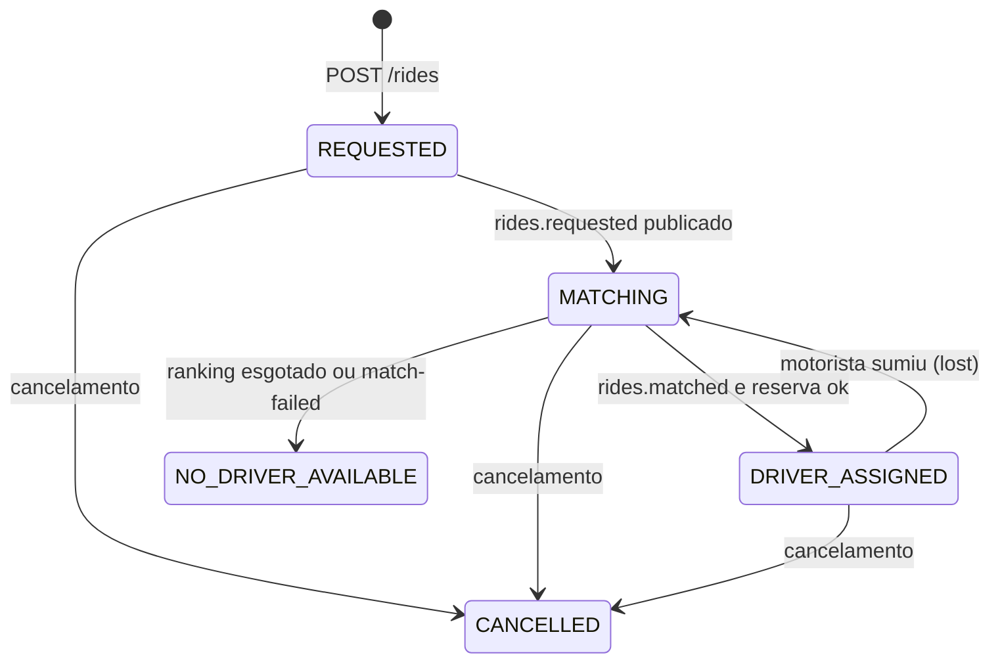
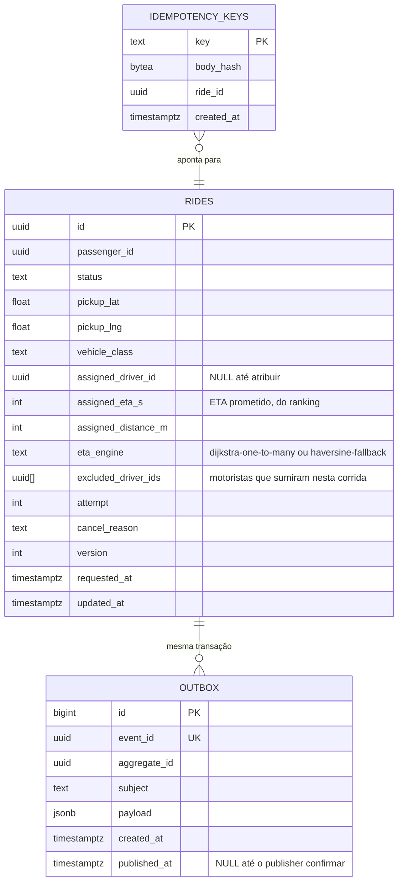

# ride-service

Dono do estado do pedido de corrida. É o único serviço que pode criar, atribuir
ou cancelar uma corrida. Matching escolhe; este serviço decide se a escolha vale
e grava o resultado.

Na v2 a corrida termina em `DRIVER_ASSIGNED`: o passageiro sabe qual motorista
vem e em quanto tempo. Não há destino, rota nem viagem.

Roda em **2 réplicas** atrás do nginx. Qualquer uma atende, porque o estado está
no PostgreSQL.

## O que faz

1. Recebe `POST /rides` com o ponto de embarque, valida o pedido e grava a
   corrida em `REQUESTED` junto com o evento na outbox, na mesma transação.
   Responde `202` sem esperar motorista.
2. Um publisher interno lê a outbox e publica `rides.requested` no Kafka.
3. Consome `rides.matched`, reserva o primeiro motorista livre do ranking e
   passa a corrida para `DRIVER_ASSIGNED`, gravando o ETA que veio no ranking.
   Publica `rides.assigned`.
4. Consome `rides.match-failed` e passa para `NO_DRIVER_AVAILABLE`.
5. Consome `drivers.presence` (`lost`): volta a corrida para `MATCHING`,
   publica `rides.released` e um novo `rides.requested` sem aquele motorista.
6. Aplica o cancelamento pedido pelo cliente. Se havia motorista, publica
   `rides.released`.

A corrida existe no banco **antes** de qualquer busca.



`DRIVER_ASSIGNED` é o estado final de sucesso na v2. `CANCELLED` e
`NO_DRIVER_AVAILABLE` (depois do limite de tentativas) também não saem para
outro estado. Atribuir de novo uma corrida que já tem motorista é rejeitado
pelo agregado.

O rematch por `lost` conta como tentativa. Passado o limite (`attempt`), a
corrida vai para `NO_DRIVER_AVAILABLE`.

## Contratos HTTP

Base pública, atrás do nginx. Erro em `application/problem+json`, sempre com
`trace_id`.

| Método | Caminho | Quem chama | Resposta |
| --- | --- | --- | --- |
| `POST` | `/rides` | App do passageiro | `202` com `id`, `status: REQUESTED` e `Location` |
| `GET` | `/rides/{id}` | App do passageiro | Estado atual, motorista e ETA quando existirem |
| `GET` | `/rides/{id}/events` | App do passageiro | SSE, um evento por transição |
| `POST` | `/rides/{id}/cancel` | Passageiro | `200` com `CANCELLED`. Repetir também devolve `200` |
| `GET` | `/healthz`, `/readyz` | nginx | liveness e readiness |

`POST /rides` exige o header `Idempotency-Key`. A mesma chave com o mesmo corpo
devolve a corrida já criada (`200`). A mesma chave com corpo diferente devolve
`409`.

`GET /rides/{id}?wait=3s` segura a conexão por até 3 segundos se o estado ainda
for `REQUESTED` ou `MATCHING`, e responde assim que mudar. `ETag` é a `version`
do agregado; `If-None-Match` devolve `304`.

Exemplo de aceite:

```http
POST /rides
Content-Type: application/json
Idempotency-Key: 4f2c9e1a-7b11-4c2a-9f01-0a1b2c3d4e5f
X-Request-Id: req-abc123

{
  "passenger_id": "018f3a2b-1111-7abc-8def-0123456789ab",
  "pickup": { "lat": -23.5613, "lng": -46.6565 },
  "vehicle_class": "standard"
}
```

```json
{ "id": "018f3a2b-2222-7abc-8def-0123456789ab", "status": "REQUESTED", "poll_after_ms": 300 }
```

Consulta depois da atribuição:

```json
{
  "id": "018f3a2b-2222-7abc-8def-0123456789ab",
  "status": "DRIVER_ASSIGNED",
  "pickup": { "lat": -23.5613, "lng": -46.6565 },
  "driver": {
    "id": "018f9c00-3333-7abc-8def-0123456789ab",
    "eta_s": 142,
    "distance_m": 820,
    "eta_engine": "dijkstra-one-to-many"
  },
  "version": 4
}
```

## Comunicação com outras aplicações

| Destino | Canal | Para quê |
| --- | --- | --- |
| `matching-service` | **Kafka** `rides.requested` (produz) | Disparar a busca sem prender a conexão do passageiro |
| `matching-service` | **Kafka** `rides.matched` e `rides.match-failed` (consome) | Receber o ranking, ou a falha |
| `driver-service` | **Kafka** `rides.assigned` (produz) | O motorista sai dos disponíveis |
| `driver-service` | **Kafka** `rides.released` (produz) | O motorista volta aos disponíveis após cancelamento ou rematch |
| `driver-service` | **Kafka** `drivers.presence` (consome) | `lost`, para rematch |

Este serviço **não faz chamada REST** para nenhum outro. Na v2 a atribuição não
depende do `routing-service`: o ETA prometido já vem no ranking.

## Kafka — por que esta aplicação usa

O matching leva dezenas ou centenas de milissegundos e depende de outros dois
serviços. O Kafka separa o aceite (validar, gravar, responder) da busca.
Consumer group `ride-workers`: as duas réplicas competem.

Estado e linha da `outbox` entram na mesma transação. Um processo em background
publica o que ainda está com `published_at` nulo e só então marca a linha. Cair
entre o commit e o publish reenvia o mesmo `event_id`.

| Tópico | Papel aqui | Chave | Retenção |
| --- | --- | --- | --- |
| `rides.requested` | produz | `ride_id` | 7 dias |
| `rides.assigned` | produz | `ride_id` | 7 dias |
| `rides.released` | produz | `ride_id` | 7 dias |
| `rides.matched` | consome | `ride_id` | 7 dias |
| `rides.match-failed` | consome | `ride_id` | 7 dias |
| `drivers.presence` | consome | `driver_id` | 1 hora |

`rides.requested` leva `attempt`, e o matching o devolve no resultado. Isso
permite descartar um ranking de uma tentativa anterior ao rematch.
`rides.assigned` e `rides.released` levam `ride_id` e `driver_id`.

## Cache — por que esta aplicação usa

Redis, sem persistência.

| Chave | TTL | Uso | Se o Redis sumir |
| --- | --- | --- | --- |
| `idem:{key}` | 24 h | Atalho da `Idempotency-Key` do `POST /rides` | A tabela `idempotency_keys` responde a mesma pergunta |
| `driver:{id}:res` | 30 s | `SETNX` com o `ride_id`: reserva rápida antes de gravar a atribuição | O índice único parcial em `rides.assigned_driver_id` impede duas corridas ativas para o mesmo motorista |

O `SETNX` falha rápido e o serviço tenta o próximo do ranking. Ele não é a
garantia final: o índice único é.

## Banco de dados

Schema `ride`, usuário com `GRANT` só nesse schema.

1. **Transação** entre a linha da corrida e a linha da outbox.
2. **Índice único parcial**: um `assigned_driver_id` só aparece em uma corrida
   `DRIVER_ASSIGNED`.
3. **`version` otimista**: dois consumidores da mesma mensagem não sobrescrevem
   um ao outro.



Índices que existem por correção:

- único em `assigned_driver_id` onde `status = 'DRIVER_ASSIGNED'`;
- `(status, updated_at)` onde o status ainda não é terminal, para achar corrida
  presa e retentar.

## Telemetria

| Métrica | Tipo | Por quê |
| --- | --- | --- |
| `http.server.duration` de `POST /rides` e `GET /rides/{id}` | histograma | O aceite não pode depender do matching |
| `ride.time_to_assign_ms` | histograma | Do `POST` ao `DRIVER_ASSIGNED`: o tempo que o passageiro sente |
| `ride.reservation_conflict` | contador | `SETNX` que falhou e passou para o próximo |
| `ride.ranking_exhausted` | contador | Ranking inteiro tomado por outras corridas |
| `ride.status_transitions` por de/para | contador | Fluxo da máquina de estados |
| `ride.rematch` | contador | Rematch por `lost` |
| `outbox.pending` e `outbox.publish_lag_ms` | gauge | Eventos gravados e ainda não publicados |
| `kafka.consumer.lag` (`rides.matched`) | gauge | Rankings esperando atribuição |

Spans: `POST /rides` com a transação e a outbox, publish do outbox, consumo de
`rides.matched` com a reserva e a gravação. O `trace_id` do `POST` aparece no
span de atribuição.

## Idempotência

| Entrada repetida | O que acontece |
| --- | --- |
| `POST /rides` com a mesma `Idempotency-Key` e o mesmo corpo | Devolve a corrida original |
| `rides.matched` entregue duas vezes | A segunda não passa de `MATCHING` para `DRIVER_ASSIGNED`. O consumidor dá ack |
| `rides.matched` ou `rides.match-failed` de uma tentativa anterior | `attempt` do evento é menor que o da corrida; ignorado |
| `lost` repetido para a mesma corrida | Só a primeira tira de `DRIVER_ASSIGNED` |
| `POST /cancel` em corrida já `CANCELLED` | `200` com o mesmo recurso |

Log JSON com `service=ride-service`, `trace_id`, `event_id` e `ride_id`.
